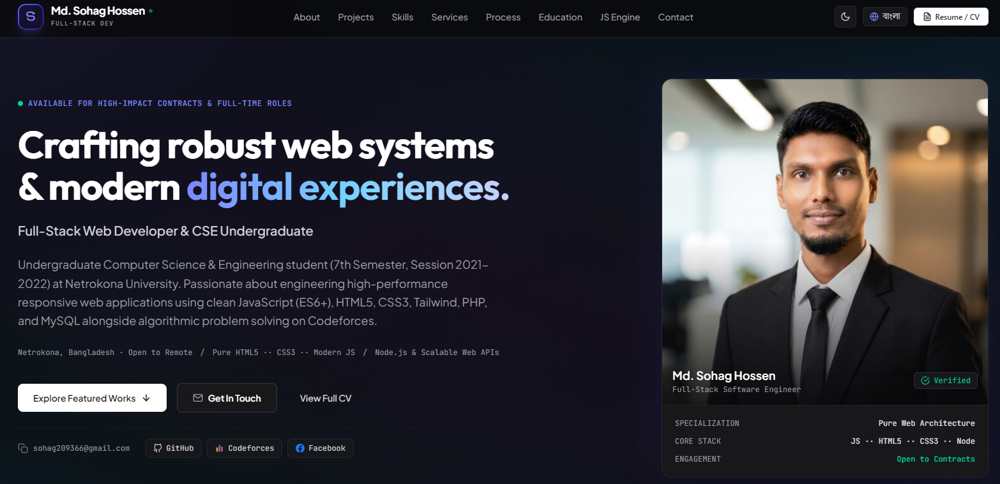

# MD. SOHAG HOSSEN — Developer Portfolio

<div align="center">
  
</div>

## About

This is my personal developer portfolio website, designed to showcase my skills, services, projects, and professional background.

## Features

- Modern and Responsive Design
- Dark and Light Mode
- Interactive Navigation
- About Me Section
- Skills and Services Showcase
- Project Portfolio
- Contact Section
- Mobile-Friendly Layout

## Technologies Used

- HTML5
- CSS3
- JavaScript
- Font Awesome
- Google Fonts

## Installation & Setup

### Prerequisites

- Node.js
- npm

### Run Steps

```bash
npm install
npm run dev
```

## Author

**Md. Sohag Hossen**  
Computer Science & Engineering Student  
Netrokona University
